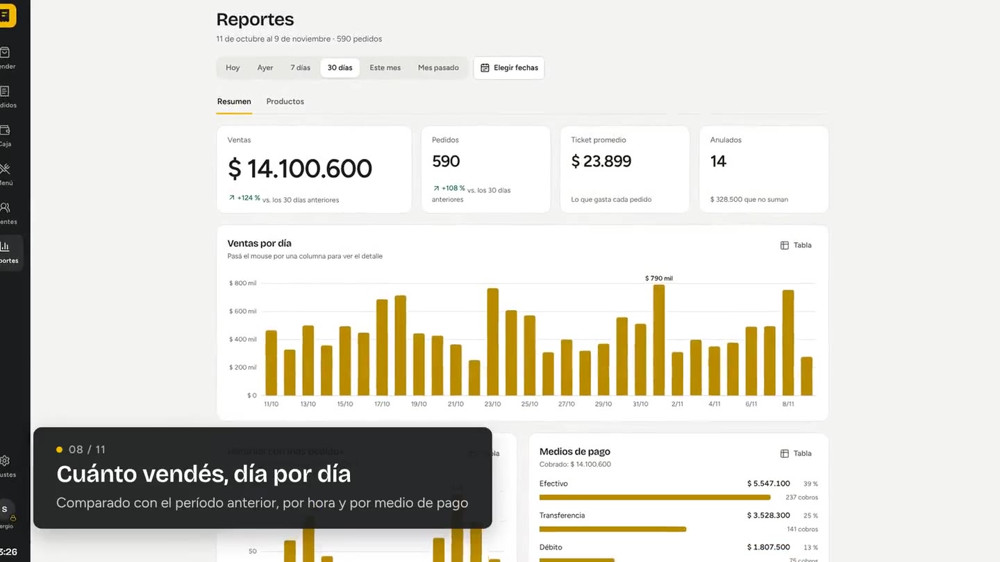
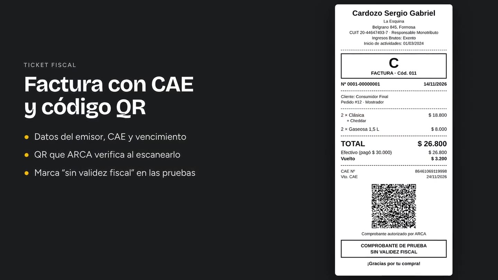

# Caja

Punto de venta para locales de comida (rotiserías, pizzerías, hamburgueserías y cafeterías) con facturación electrónica de ARCA (ex AFIP). Es una aplicación de escritorio para Windows que cubre todo el día del mostrador: tomar el pedido, cobrar, avisar a la cocina, imprimir el ticket, cerrar la caja y ver cómo se vendió.



[Ver el video de la demo en mi portafolio](https://sergio-cardozo.vercel.app/#p-caja)

## Qué hace

- Venta táctil con tamaños, agregados y notas para la cocina, para mostrador, para llevar, delivery o mesa.
- Cobro en efectivo con vuelto, transferencia, débito, crédito, QR o combinando medios.
- Tablero de cocina, comandas y tickets para impresora térmica o en PDF.
- Apertura y cierre de caja con arqueo: muestra si sobra o falta plata.
- Usuarios con PIN y permisos para el dueño y los cajeros.
- Reportes con gráficos: ventas por día y por hora, medios de pago, lo más vendido y comparación con el período anterior.
- Copias de seguridad automáticas y manuales, y datos de ejemplo para probarlo.

### Facturación electrónica ARCA



- Factura C para monotributo y A o B para responsable inscripto, a consumidor final, DNI o CUIT.
- Si ARCA no responde, el pedido queda cobrado con la factura pendiente para reintentar.
- Al anular un pedido facturado, primero se emite la nota de crédito y recién después se anula.
- Ticket fiscal con los datos del emisor, CAE, vencimiento y código QR.
- Libro de ventas en pantalla y exportable a Excel para el contador.
- Alta de cada local desde el programa: genera la clave y el pedido de certificado, con una guía paso a paso.

La integración se probó contra el ambiente de homologación (pruebas) de ARCA.

## Aspectos técnicos

- **Integración con ARCA hecha a mano:** la firma digital, el cliente de los servicios de ARCA, el código QR y el Excel están programados sin librerías externas.
- **La clave fiscal no sale del proceso principal:** la clave y el certificado nunca llegan a la ventana. Los PIN se guardan con hash y sal, y los permisos se controlan en cada operación.
- **No se pierde ninguna venta:** si ARCA falla, la venta queda cobrada y la factura pendiente. El dinero se guarda en centavos y las anulaciones no borran nada.

## Tecnologías

Electron · React · TypeScript · Tailwind CSS · shadcn/ui · TanStack Query · Zod · SQLite con Drizzle · Vitest

## Cómo ejecutarlo

Necesitás [Node.js](https://nodejs.org) en su versión LTS.

```bash
npm install
npm start          # abre la aplicación en modo desarrollo
npm test           # corre las pruebas automatizadas
npm run typecheck  # revisa los tipos de TypeScript
npm run make       # genera el instalador (en Windows, el .exe)
```

La primera vez que se abre, el sistema pide crear al dueño con su PIN. Desde la sección de copias de seguridad, el dueño puede cargar datos de ejemplo mientras no haya pedidos.

## Estructura

```
src/
  main/        proceso principal de Electron: base de datos, servicios y canales IPC
  preload/     puente seguro entre la ventana y el proceso principal
  renderer/    interfaz en React
  compartido/  tipos, esquemas de Zod y cálculos que usan los dos lados
pruebas/       pruebas automatizadas con Vitest
```

## Autor

**Sergio Cardozo**, desarrollador full stack en Formosa, Argentina.
[Portafolio](https://sergio-cardozo.vercel.app) · [LinkedIn](https://www.linkedin.com/in/sergiocardozo-dev) · [GitHub](https://github.com/Gabicrdz)
